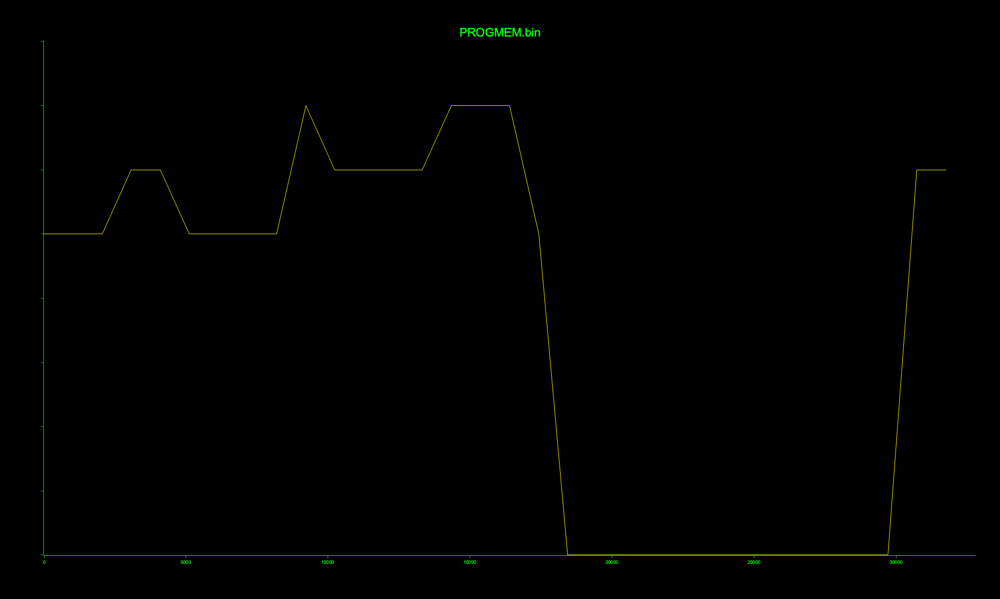

#+title: M1 Embedded - Board 9 Deliverables
#+options: toc:2

* Arduino identification number

*Arduino ID: 9*

* Overview

This directory is the submission for the "Insecure vending machine" embedded
security assignment, carried out against *Arduino board 9*. Each attack target
lives under [[file:TARGETS/][=TARGETS/=]] in its own =target-<n>/= sub-folder. Every completed
target carries its own =README.org= with the full procedure, the raw-data /
proof-of-work artifact, and the answer to that target's data-bound question;
this top-level file is the index that links them and collects the final
secrets.

* Recovered secrets

The canonical one-line summary required by the assignment is in
[[file:TARGETS/secrets.csv][=TARGETS/secrets.csv=]]. Its fields, in order:

| # | Field                        | Value                                                    |
|---+------------------------------+----------------------------------------------------------|
| 1 | Arduino ID                   | =9=                                                      |
| 2 | Dan's password               | =danrgwygtrkvk=                                          |
| 3 | Alan's password              | =alanzvnswtxmjxjcikzpmemegrjqaugjmidnmxiynjghxmdnlffbmw= |
| 4 | c&c password                 | =cncgijucsnrdyfwsatpqxiodhlnqrfxutzzygjtmnkmofphuhzzaj=  |
| 5 | Final secret                 | =honeyglovechalkgrass=                                   |
| 6 | c&c password MD5             | =37190c6e8cf5b3fbe5eb96f631d4ca85=                       |
| 7 | PROGMEM firmware SHA-256     | =5c41d08e46cbfe952fb0e2b0d6b52264226b8de188cebe7309ed5dba37e63438= |

* Environment / reproduction

All Python tooling targets the serial console at =/dev/cu.usbserial-10= @
=115200= baud (adjust =PORT= in each script for your host). Dependencies are
pinned in [[file:../requirements.txt][=../requirements.txt=]]; install with:

#+begin_src sh
  python3 -m venv .venv && . .venv/bin/activate
  pip install -r ../requirements.txt
#+end_src

The firmware-analysis steps rely on standard CLI tools: =shasum=, =xxd=,
=strings=, =python3=, and =openssl=.

* Targets

** Target 1 - Developer password (timing attack)
Status: *complete.* Writeup: [[file:TARGETS/target-1/README.org][=TARGETS/target-1/README.org=]].

Artifacts under [[file:TARGETS/target-1/][=TARGETS/target-1/=]]:
- Raw timing data: =timing-length.csv= (length probes) and =timing-chars.csv=.
- Figures: =length.png=, =position-1.png=, =position-2.png=...
- Scripts: [[file:TARGETS/target-1/scripts/main.py][=scripts/main.py=]] runs the timing attack and writes the CSVs;
   [[file:TARGETS/target-1/scripts/plot.py][=scripts/plot.py=]] redraws the figures from them.

Invocation (from =target-1/scripts/=, board connected):
#+begin_src sh
  ./main.py && ./plot.py
#+end_src

Answers (see the inner README for evidence):
- Inferred length: =13= (the only length that rises ~1 ms above its neighbours).
- Per-position winning-char margins: ~1.0 ms each (staircase of ~1 ms delay
  steps); position 1 is =+2.00= ms (filler =a= matches the real 2nd char).
- Smallest margin: all are ~1 ms (one delay step - the floor), spanning only
  +0.974 .. +1.012 ms; which position is numerically smallest is measurement
  noise and shifts from run to run. Position 13's ~1 ms is a login-branch cost, not
  an added delay step, so the last character is confirmed by the login banner.
- Recovered developer password: =danrgwygtrkvk=.

** Target 2 - Firmware dump
Status: *complete.* Writeup: [[file:TARGETS/target-2/README.org][=TARGETS/target-2/README.org=]].

Artifacts under [[file:TARGETS/target-2/][=TARGETS/target-2/=]]:
- Dumps: =PROGMEM.bin=, =SRAM.bin=, =EEPROM.bin=.
- Digests: =PROGMEM_SHA256=, =SRAM_SHA256=, =EEPROM_SHA256=.
- Dumper: [[file:TARGETS/target-2/scripts/main.py][=scripts/main.py=]] - drives the dev console over serial, logs in as
  Dan, lists the advertised memory locations, and dumps each to a =.bin= plus a
  =_SHA256= sidecar.

Invocation (from =target-2/scripts/=, board connected):
#+begin_src sh
  ./main.py
#+end_src

Answers (see the inner README for evidence):
- PROGMEM SHA-256: =5c41d08e46cbfe952fb0e2b0d6b52264226b8de188cebe7309ed5dba37e63438=
- PROGMEM byte length: =32768= bytes.
- Developer password offset: =0x2BC= (700).

** Target 3 - Confidential strings
Status: *complete.* Writeup: [[file:TARGETS/target-3/README.org][=TARGETS/target-3/README.org=]].

Artifacts under [[file:TARGETS/target-3/][=TARGETS/target-3/=]]: the full [[file:TARGETS/target-3/STRINGS.txt][=STRINGS.txt=]] dump (strings
of PROGMEM/SRAM/EEPROM) and the annotated asset table in the inner README. The
regeneration command is embedded in that README.

Answers (see the inner README for the annotated offset table):
- Second maintenance password: =ffnetxynupribytlrabu= at =0x4474= (17524).
- Offset relative to the developer password (=0x2BC=): =0x41B8= = 16824 bytes.
- base64 blobs: RSA private key = 1592 chars (1192 raw bytes); signature = 344
  chars (256 raw bytes).

** Target 4 - Identify cryptographic assets
Status: *complete.* Writeup: [[file:TARGETS/target-4/README.org][=TARGETS/target-4/README.org=]].

Artifacts under [[file:TARGETS/target-4/][=TARGETS/target-4/=]]:
- [[file:TARGETS/target-4/rsa_private_key.pem][=rsa_private_key.pem=]], [[file:TARGETS/target-4/signature.pem][=signature.pem=]] - the two base64 blobs from
  Target 3, re-wrapped as PEM.
- [[file:TARGETS/target-4/asn1parse.txt][=asn1parse.txt=]], [[file:TARGETS/target-4/rsa-text.txt][=rsa-text.txt=]] - =openssl asn1parse= / =openssl rsa -text=
  of the key.
-  - =binwalk -E= Shannon-entropy scan of the firmware.
- Scripts: [[file:TARGETS/target-4/scripts/blobs.py][=scripts/blobs.py=]] (extracts the blobs -> PEMs),
  [[file:TARGETS/target-4/scripts/openssl.sh][=scripts/openssl.sh=]], [[file:TARGETS/target-4/scripts/entropy.sh][=scripts/entropy.sh=]] (regenerate the outputs).

Answers (see the inner README for evidence):
- Key size: RSA *2048-bit*, two primes, =publicExponent= 65537 (=0x10001=).
- Structural giveaway: the decoded DER header =30 82 04 a4 02 01 00 02 82 01 01
  00= - =30= SEQUENCE marks DER, =02 01 00= is the PKCS#1 version INTEGER (only
  an =RSAPrivateKey= carries it), and =02 82 01 01= + =00= is the 257-byte
  (2048-bit) modulus.
- Signature size: *256 bytes* (2048 bits), no ASN.1 wrapper - a bare RSA block.
- Entropy: key/signature region ~5.98 bits/byte base64 (~7.83 decoded) vs
  ~4.5-4.8 for the AVR code region.

** Target 5 - c&c password
Status: *complete.* Writeup: [[file:TARGETS/target-5/README.org][=TARGETS/target-5/README.org=]].

Artifacts under [[file:TARGETS/target-5/][=TARGETS/target-5/=]]:
- [[file:TARGETS/target-5/decrypted-hash.bin][=decrypted-hash.bin=]] - the decrypted-signature payload (=hash= JSON).
- [[file:TARGETS/target-5/openssl-decrypt-transcript.txt][=openssl-decrypt-transcript.txt=]] - the =openssl= decrypt transcript.
- [[file:TARGETS/target-5/rainbow-lookup-result.txt][=rainbow-lookup-result.txt=]] - the rainbow-table lookup result.
- [[file:TARGETS/target-5/scripts/run.sh][=scripts/run.sh=]] - PEM-unwraps =signature.pem= to raw bytes, then
  =openssl pkeyutl -decrypt= - emits the payload.

Invocation (from =target-5/scripts/=):
#+begin_src sh
  ./run.sh
#+end_src

Answers (see the inner README for evidence):
- MD5 from the decrypted signature: =37190c6e8cf5b3fbe5eb96f631d4ca85=.
- c&c password: =cncgijucsnrdyfwsatpqxiodhlnqrfxutzzygjtmnkmofphuhzzaj=.
- A short rainbow table suffices because unsalted MD5 is deterministic and the
  password keyspace is tiny and structured (~100k fixed 53-char strings with the
  known =cnc= prefix), so one small precompute covers it.

** Target 6 - Crack the OTP generator
Status: *complete.* Writeup: [[file:TARGETS/target-6/README.org][=TARGETS/target-6/README.org=]].

Artifacts under [[file:TARGETS/target-6/][=TARGETS/target-6/=]]:
- [[file:TARGETS/target-6/otp-generator-capture.txt][=otp-generator-capture.txt=]] - capture showing the repeat, the recovered
  parameters, and a reproduction of the next expected value.
- [[file:TARGETS/target-6/otp-serial-capture-full.txt][=otp-serial-capture-full.txt=]] - the complete raw capture (2048 OTP prompts).
- [[file:TARGETS/target-6/scripts/main.py][=scripts/main.py=]] - submits a constant guess, harvests each revealed "was
  expecting N", and stops when a value repeats.

Invocation (from =target-6/scripts/=, board connected):
#+begin_src sh
  ./main.py
#+end_src

Answers (see the inner README for evidence):
- Generator: =x_{n+1} = (3693 * x_n) mod 4096= (multiplicative / Lehmer, C = 0).
- Attempts until repeat: =1024= (period 1024).
- Repeated value: =3511= (this boot's seed).
- Next OTP: =(3693 * V) mod 4096= for the last observed =V=.

** Target 7 - Final secret
Status: *complete.* Writeup: [[file:TARGETS/target-7/README.org][=TARGETS/target-7/README.org=]].

Artifacts under [[file:TARGETS/target-7/][=TARGETS/target-7/=]]:
- [[file:TARGETS/target-7/cc-connection-transcript.txt][=cc-connection-transcript.txt=]] - serial transcript of the successful C&C
  connection, showing OTP acceptance and the final-secret line.
- [[file:TARGETS/target-7/scripts/connect.py][=scripts/connect.py=]] - logs in, then answers the OTP challenge with the
  predicted value from the Target 6 generator.
- [[file:TARGETS/target-7/scripts/otp-params.conf][=scripts/otp-params.conf=]] - recovered generator parameters (A, M).

Answers (see the inner README for evidence):
- Final secret: =honeyglovechalkgrass= (also recorded in =secrets.csv=).
- T5 + T6 combined: authenticate with the Target 5 c&c password to reach the OTP
  prompt, send one guess to learn the board's current expected value, then
  submit the Target 6 generator's next output.
