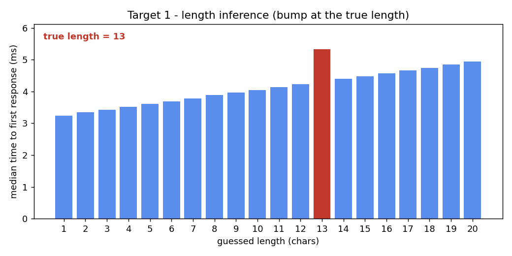

#+title: Target 1 - Developer password (timing attack)

* Artifacts
- scripts/main.py - the attack: infers the password length, then recovers it
  character by character from response timing. Self-contained - nothing about
  the password is assumed; the length, every character, and the final
  confirmation come only from the board's own responses. Writes every raw
  sample to the two CSVs below.
- scripts/plot.py - redraws the figures from those CSVs (reproducible).
- timing-length.csv - raw length-probe samples (=length, sample, elapsed_ms=).
- timing-chars.csv - raw character-probe samples
  (=position, candidate, sample, elapsed_ms=).
- length.png - median time per guessed length; length 13 stands ~1 ms above its
  neighbours (the one delay step from entering the compare loop).
- position-1.png .. position-13.png - median response time per candidate letter
  at each password position; the slowest (red) is the recovered character. The
  target only asks for the first two; the rest are included for completeness.
  Position 13 shows only =a=..=k= - the correct =k= logs us in, so the search
  stops there.

* The leak
The dev console prompts =Enter password for vending machine number 9:= and, on a
wrong guess, replies =Login failure= and re-prompts. The validation is *not*
constant-time:

#+begin_src c
  if (strlen(input) != strlen(secret)) return FAIL;   // length checked first
  for (i = 0; i < len; i++) {
      delay(D);                                        // ~1 ms per step
      if (input[i] != secret[i]) return FAIL;          // early return on mismatch
  }
  return OK;                                           // prints the login banner
#+end_src

So the time from our newline to the board's first reply byte grows by one =D=
(~1 ms) for every leading character we get right. We measure that interval
host-side with =time.perf_counter()= around a blocking one-byte read; the board
does not echo and only speaks after validating, so the interval *is* the
validation delay.

* Method
Two phases:

1. *Length.* Probe =a*L= for =L= in 1..20 (the assignment caps length at 20).
   Only the correct length clears the length check and pays one =delay(D)= in the
   compare loop, so it rises ~1 ms above its neighbours. The absolute times also
   carry a gentle ramp with =L= (the serial transmit time of a longer guess),
   which the board itself does not cause, so we score each length by its rise
   *above its neighbours* rather than by a plain global maximum.
2. *Characters.* With the first =i= characters known, send
   =prefix + candidate + filler= padded to length 13; the correct candidate
   survives one extra =delay(D)= and is the slowest of the 26. Lock it, advance.
   The 13th character is the one the board *accepts*: it switches from
   =Login failure= to the developer-menu banner, which is how we confirm it.

We sample one pass over all candidates per round, 30 rounds and
take the median per candidate, so any slow drift during a round is shared across
candidates and cancels out.

#+begin_src sh
  cd scripts && ./main.py      # board connected; writes the two CSVs
  ./plot.py                    # redraws length.png / position-1.png / position-2.png ...
#+end_src

Result: recovered *danrgwygtrkvk*

* Q: What length did you infer?
*13 characters.* Length 13 rises a full delay step above its neighbours, and the
recovered 13-character password is then *accepted* by the board.

#+begin_src text
  len 12 = 4.23 ms   len 13 = 5.33 ms   len 14 = 4.40 ms
  rise above neighbours: +1.01 ms at length 13 (one delay(D))
#+end_src

* Q: Timing margin of the winning character at each position
Margin = median(winning letter) - median(runner-up). The winner's median climbs
~1 ms per position - the staircase of accumulated =delay(D)= steps:

| pos | letter | winner median (ms) | runner-up (ms) | margin (ms) |
|-----+--------+--------------------+----------------+-------------|
|   1 | d      |              7.336 |          5.340 |      +1.996 |
|   2 | a      |              7.363 |          6.367 |      +0.996 |
|   3 | n      |              8.360 |          7.366 |      +0.994 |
|   4 | r      |              9.378 |          8.374 |      +1.004 |
|   5 | g      |             10.383 |          9.404 |      +0.979 |
|   6 | w      |             11.429 |         10.418 |      +1.012 |
|   7 | y      |             12.400 |         11.413 |      +0.988 |
|   8 | g      |             13.425 |         12.428 |      +0.997 |
|   9 | t      |             14.434 |         13.439 |      +0.995 |
|  10 | r      |             15.443 |         14.456 |      +0.987 |
|  11 | k      |             16.437 |         15.463 |      +0.974 |
|  12 | v      |             17.471 |         16.467 |      +1.004 |
|  13 | k      |             18.550 |         17.569 |      +0.981 |

The winner's median climbs ~1 ms per position - the staircase of accumulated
=delay(D)= steps. Positions 2-13 all sit within noise of one delay step
(~1 ms). Position 1 is the outlier at *+1.996 ms*: the filler =a= is also the
real second character, so the correct =d= clears two matching steps (=d= then the
filler =a=) before mismatching - two =delay(D)= instead of one. That is an
artifact of the filler, not of the console. (Position 13 is measured only up to
the winning letter: the correct guess logs us in, so the search stops there.)

* Q: Which position had the smallest margin, and why?
Every margin is essentially *one delay step* (~1 ms) - that is the floor, and
positions 2-13 all reach it. They span only *+0.974 .. +1.012 ms*, a spread well
inside measurement noise, so *no position has a margin structurally below one
delay step*. Which one is numerically smallest is therefore not meaningful - it
shifts from run to run - so we do not read anything into it. Two positions are
structurally special:

- *Position 1 is the largest* (+1.996 ms), not the smallest, because our filler
  letter equals the real second character (see the table note above).
- *Position 13* is a full ~1 ms like the rest, but that millisecond is not an
  added =delay(D)=: the compare loop runs 13 times whether the last letter is
  right or wrong, so the final character earns no extra step. The ~1 ms there is
  only the firmware branching to the login banner instead of =Login failure= - a
  less reliable signal, which is why =main.py= confirms the last character from
  the *response content* (login success) rather than from its timing margin.

* Recovered password
=danrgwygtrkvk=

* Reference
For how a timing attack is structured (the per-character max-median sweep and the
winner / runners-up reporting) we looked at Sqreen's security best-practices
example:
https://github.com/sqreen/DevelopersSecurityBestPractices/blob/master/_practices/timing-attack/_python/hack.py
