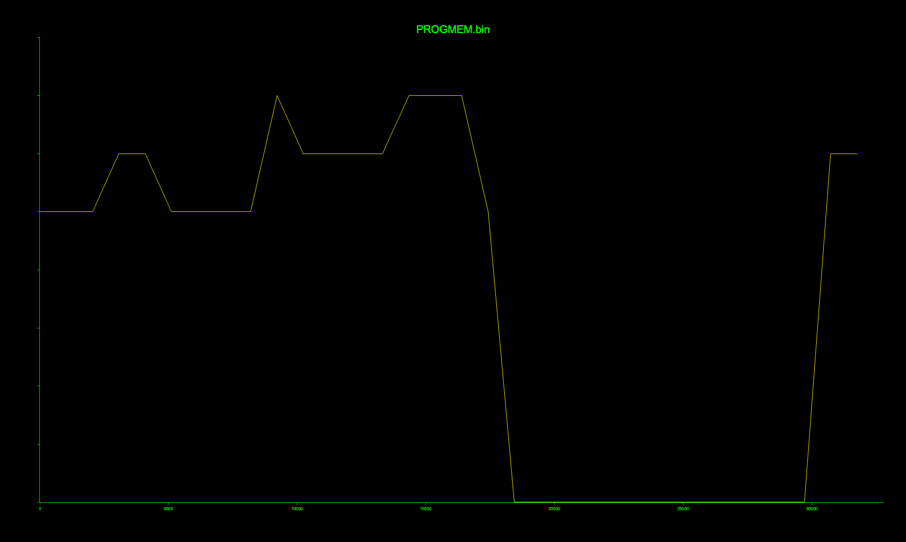

#+title: Target 4 - Identify cryptographic assets

* Artifacts
| File                  | What it is                                           |
|-----------------------+------------------------------------------------------|
| rsa_private_key.pem   | blob #1 re-wrapped as a PEM RSA PRIVATE KEY          |
| signature.pem         | blob #2 re-wrapped as base64 (256 raw bytes)         |
| asn1parse.txt         | openssl asn1parse of the key (DER structure)         |
| rsa-text.txt          | openssl rsa -text of the key (decoded parameters)    |
| progmem-entropy.png   | binwalk -E Shannon-entropy scan of the firmware      |
| scripts/blobs.py      | extracts both blobs from PROGMEM.bin -> the two PEMs |
| scripts/openssl.sh    | regenerates asn1parse.txt and rsa-text.txt           |
| scripts/entropy.sh    | regenerates progmem-entropy.png                      |

* Q: What is the key size?
Key size: *RSA 2048-bit*, two primes, publicExponent *65537 (0x10001)*.

#+begin_src sh
  > cd scripts && ./openssl.sh      # writes ../asn1parse.txt, ../rsa-text.txt
  > grep -E "Private-Key|publicExponent" ../rsa-text.txt
  Private-Key: (2048 bit, 2 primes)
  publicExponent: 65537 (0x10001)
#+end_src

* Q: Which structural (ASN.1/DER) bytes told you what it was?
The decoded header: *30 82 04 a4  02 01 00  02 82 01 01 00*

#+begin_src sh
  > python3 -I -c 'import base64;print(base64.b64decode("MIIEpAIBAAKCAQEA").hex(" "))'
  30 82 04 a4 02 01 00 02 82 01 01 00
#+end_src

- 30         SEQUENCE tag -> DER-structured, not opaque ciphertext
- 82 04 a4   long-form length 0x04A4 = 1188 bytes
- 02 01 00   INTEGER version = 0 -> two-prime RSAPrivateKey
- 02 82 01 01 00  257-byte modulus INTEGER (256-byte / 2048-bit + sign byte)

* Q: How many bytes is the encrypted signature?
Signature: *256 bytes* (2048 bits), matching the modulus size. The 344 base64
chars of blob #2 decode to 256 raw bytes with no ASN.1 wrapper, a bare RSA
signature block.

#+begin_src sh
  > python3 -I -c 'import base64;print(base64.b64decode("b+gJJKG56gAz").hex(" "))'
  6f e8 09 24 a1 b9 ea 00 33    # no 30/02 structure -> opaque signature
#+end_src

* Q: Key region entropy vs a code region?
The key/signature region is higher than the low-entropy machine code near the start of PROGMEM.

#+begin_src sh
  cd scripts && ./entropy.sh      # writes ../progmem-entropy.png (binwalk -E)
#+end_src

