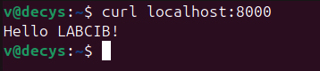
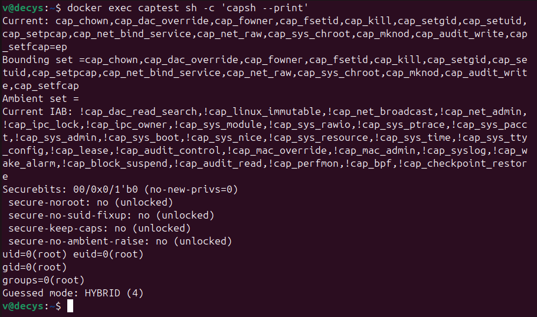
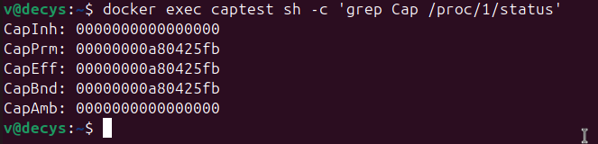
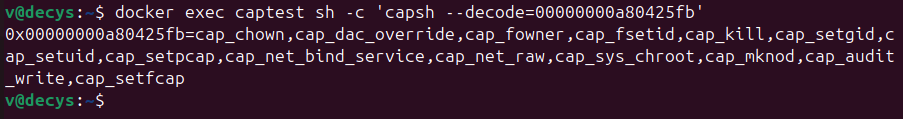
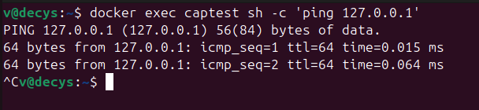
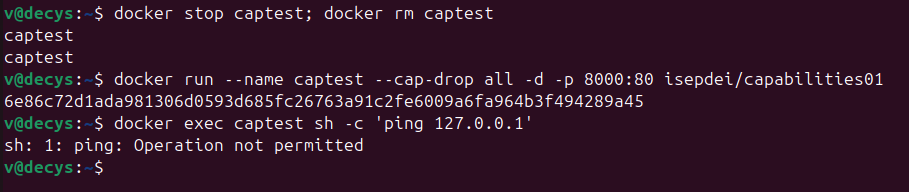
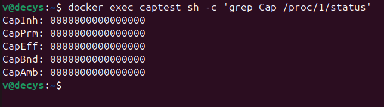
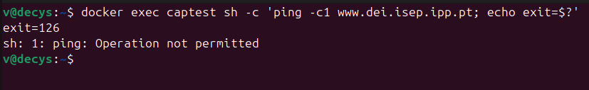
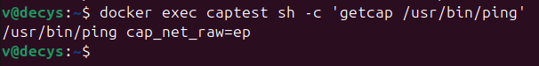
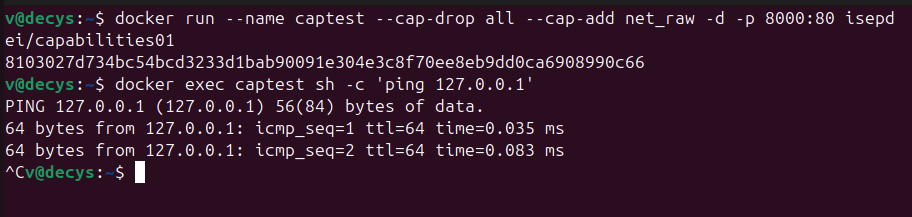

#+title: Isolation Part 2 - capabilities inside Docker (Q12, Q13)

* Q12: inheritable / permitted / effective capabilities in the container

#+begin_src sh
  > docker run --name captest -d -p 8000:80 isepdei/capabilities01
  > curl localhost:8000
#+end_src

#+begin_src sh
  > docker exec captest sh -c 'capsh --print'
#+end_src

#+begin_src sh
  > docker exec captest sh -c 'grep Cap /proc/1/status'
#+end_src

#+begin_src sh
  > docker exec captest sh -c 'capsh --decode=00000000a80425fb'
#+end_src

** proc filesystem (=/proc/1/status=)

| field      | value              | meaning                                   |
|------------+--------------------+-------------------------------------------|
| CapInh     | =0000000000000000= | inheritable: *empty*                      |
| CapPrm     | =00000000a80425fb= | permitted: the 14 default capabilities    |
| CapEff     | =00000000a80425fb= | effective: same 14 (active)               |
| CapBnd     | =00000000a80425fb= | bounding: caps may never exceed these 14  |
| CapAmb     | =0000000000000000= | ambient: empty                            |

- *Inheritable = 0* and *Ambient = 0*: nothing is passed across an =execve= to
  non-privileged programs; capabilities come from the file/bounding rules, not
  inheritance.
- *Permitted = Effective*: every capability the container has is already active.
- *Bounding = Permitted*: the container can never raise a capability outside
  this default set, even for a setuid-root binary.

Decode of =CapEff= (=capsh --decode=00000000a80425fb=), the Docker default set:

#+begin_quote
cap_chown, cap_dac_override, cap_fowner, cap_fsetid, cap_kill, cap_setgid,
cap_setuid, cap_setpcap, cap_net_bind_service, cap_net_raw, cap_sys_chroot,
cap_mknod, cap_audit_write, cap_setfcap
#+end_quote

That is 14 capabilities, a smaller subset of the 40-ish the kernel
defines. Notably *absent*: =cap_sys_admin=, =cap_net_admin=, =cap_sys_module=,
=cap_sys_ptrace=, =cap_sys_time=, etc. (the host-dangerous ones from Q10).

** Compare to =capsh --print=

=capsh --print= shows the *same* information in symbolic form rather than hex:

- =Current:= - the thread's effective/permitted/inheritable sets, i.e. the
  same 14 names listed above (permitted+effective), with inheritable empty.
- =Bounding set=- the same 14 names, matching =CapBnd=.
- =Ambient set= - empty, matching =CapAmb=.

So the =capsh= is just the human-readable decode of the numbers in =/proc/1/status=.

* Q13: ping under =--cap-drop all=, and how to fix it

#+begin_src sh
  > docker exec captest sh -c 'ping 127.0.0.1'
#+end_src

#+begin_src sh
  > docker stop captest; docker rm captest
  > docker run --name captest --cap-drop all -d -p 8000:80 isepdei/capabilities01
  > docker exec captest sh -c 'ping 127.0.0.1'
#+end_src

Yes there is an issue. Restarting with =--cap-drop all= empties every capability set,
including the *bounding* set (=CapPrm = CapBnd = 0=).

#+begin_src sh
  > docker exec captest sh -c 'grep Cap /proc/1/status'
#+end_src

The subtlety is *how* ping breaks:

#+begin_src sh
    docker run --name captest --cap-drop all -d -p 8000:80 isepdei/capabilities01
    docker exec captest sh -c 'ping -c1 www.dei.isep.ipp.pt; echo exit=$?'
    # sh: 1: ping: Operation not permitted
    # exit=126
#+end_src

** Fix

Add back the one capability ping needs, *cap_net_raw*:

#+begin_src sh
  > docker stop captest; docker rm captest
  > docker run --name captest --cap-drop all --cap-add net_raw \
    -d -p 8000:80 isepdei/capabilities01
  > docker exec captest sh -c 'ping -c2 127.0.0.1'   # works
#+end_src

