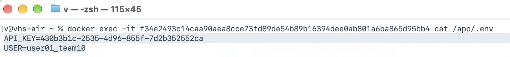

#+title: Isolation Part 1 - Answers

* Q1: What is the issue here?
The *.env* file gets bundled with the docker image.

* Q2: Can you recover the actual secrets from the image? Describe how you would do this and include a screenshot of the recovered secrets.

Yes, by connecting to the docker container, and verifying checking */app/.env*.

#+begin_src sh
  > docker exec -it <container-id> cat /app/.env

  API_KEY=430b3b1c-2535-4d96-855f-7d2b352552ca
  USER=user01_team10
#+end_src

* Q3: What do you think of Tom’s fix?
At first glance, looks fine. The *.env* file is not longer present under */app* and the program *find* does not return anything useful.
#+begin_src sh
  > docker exec -it <container-id> find . -iname "env"

  /usr/bin/env
#+end_src

Something that pops into mind is if we can reverse engineer *rm* in order to find something that traces back to file.

A quick ai-assisted google search with the title: "reverse engineer rm" yields the following answer:

#+begin_quote
AI Overview:
(...)
Because rm only destroys the metadata pointers (the map to the data) rather than overwriting the actual data blocks, the physical bits remain on your drive temporarily.
(...)
#+end_quote
