#+title: Isolation Part 2 - Answers

* Q6: What happens if you remove =cap_net_raw= from ping? Describe how you removed the capability.

** How I removed it

Check current capabilities:
#+begin_src sh
  > getcap /usr/bin/ping
  /usr/bin/ping cap_net_raw=ep
#+end_src

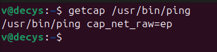

Removed via:
#+begin_src sh
  > sudo setcap -r /usr/bin/ping
  > getcap /usr/bin/ping
  (ping has no file capability)
#+end_src

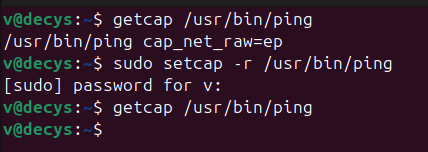

** What happens

With no capability, a non-root =ping= tries to open a raw socket, the kernel
refuses it, and ping reports the reason itself:
#+begin_src sh
  > ping 127.0.0.1
  ping: socktype: SOCK_RAW
  ping: socket: Operation not permitted
  ping: => missing cap_net_raw+p capability or setuid?
#+end_src

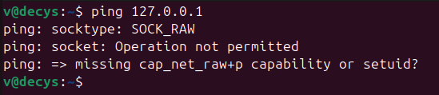

So dropping =cap_net_raw= breaks ping for ordinary users. =sudo ping= would
still work, because root bypasses the capability check.

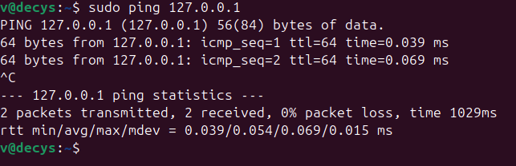

* Q7: Can you make ping work again without adding any capability, and without sudo? (video)

*Yes* by restoring the *Set UID* bit on =ping=.
A Set UID root binary runs with the file owner's privileges, which is
what ping needs to open the raw ICMP socket.

** Why this works

When a Set UID root program is executed, its effective UID becomes 0. Root
bypasses the =cap_net_raw= check, so the raw-socket open that failed in Q6 now
succeeds - with *no* file capability on the binary and *without* the user
typing =sudo=. (ping opens the socket while euid is 0, then drops back to the
real user for the rest of its run.)

** How

Set the Set UID bit:
#+begin_src sh
  > sudo chmod u+s /usr/bin/ping
  > ls -la /usr/bin/ping
  -rwsr-xr-x 1 root root ... /usr/bin/ping
  > getcap /usr/bin/ping
  (ping has no file capability)
#+end_src

Now ping works as a normal user:
#+begin_src sh
  > ping 127.0.0.1
  64 bytes from 127.0.0.1: icmp_seq=1 ttl=64 time=0.013 ms
  64 bytes from 127.0.0.1: icmp_seq=2 ttl=64 time=0.063 ms
#+end_src

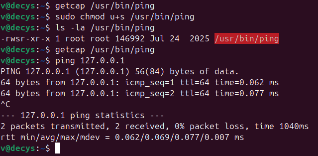

** Video

[[file:screenshots/ping-video.mov]]

* Q8: Can you make passwd work without being a Set UID program? (video)

*Yes.* =passwd= needs elevated privilege only to edit =/etc/shadow=
(=root:shadow=, mode =640=) and its backup files in =/etc=. Set UID root
is the blunt way to get that. We can get the same result by granting =passwd=
the capabilities that cover those file operations.

** How

#+begin_src sh
  # 1. remove the Set UID bit
  > sudo chmod u-s /usr/bin/passwd
#+end_src

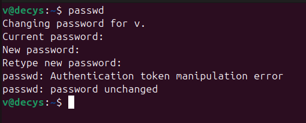

#+begin_src
  # 2. grant the capabilities the shadow rewrite needs:
  > sudo setcap cap_chown,cap_dac_override,cap_fowner=ep /usr/bin/passwd
  > passwd

#+end_src

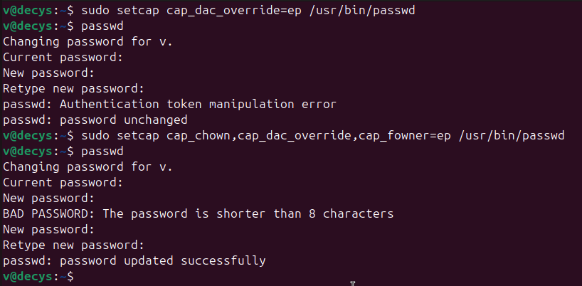

** Why these three capabilities (and why one is not enough)

=passwd=  does not just overwrite =/etc/shadow= in place; it locks
=/etc=, writes a *new* temp file, copies the old file to =shadow-=, then fixes
the new file's owner and mode and renames it over =/etc/shadow=. Each step
needs a different DAC override.

- =cap_dac_override= - bypass the read/write/search permission bits, so a
  non-owner can read and rewrite =/etc/shadow= and create the lock + temp file
  in =/etc=.
- =cap_chown= - the freshly written temp file is owned by =captest8=; passwd
  must =chown= it back to =root:shadow=. Changing a file to an owner/group you
  are not requires =CAP_CHOWN=.
- =cap_fowner= - bypass the "you must own the file" check for =chmod=/=utimes=
  on the shadow files the process does not own.

** Video

[[file:screenshots/passwd-video.mov]]

* Q9: Why is passwd Set UID by default, but ping is not?

- *ping* needs only one kernel privilege that is to open a raw socket
  (=CAP_NET_RAW=). That privilege maps onto a single capability, so
  distributions ship =ping= with =cap_net_raw=ep= and *no* setuid.

- *passwd* edits =/etc/shadow= and its lock/backup files, assuming they run as uid 0.
   Capturing all of that as one capability set is awkward.

The trade-off: =passwd='s Set UID means a bug in it is a full root compromise,
so, as the intro warns, setuid binaries "must be carefully scrutinized."
=ping='s single capability is the modern, least-privilege
alternative - it just happens that =ping='s privilege was easy to split out and
=passwd='s was not.

* Q10: Explain ten more capabilities

From the [[https://man7.org/linux/man-pages/man7/capabilities.7.html][man pages]]:

#+begin_quote

** CAP_AUDIT_CONTROL (since Linux 2.6.11)
Enable and disable kernel auditing; change auditing filter
rules; retrieve auditing status and filtering rules.

** CAP_AUDIT_READ (since Linux 3.16)
Allow reading the audit log via a multicast netlink socket.

** CAP_AUDIT_WRITE (since Linux 2.6.11)
Write records to kernel auditing log.

** CAP_BLOCK_SUSPEND (since Linux 3.5)
Employ features that can block system suspend (epoll(7)
EPOLLWAKEUP, /proc/sys/wake_lock).

** CAP_BPF (since Linux 5.8)
Employ privileged BPF operations; see bpf(2) and
bpf-helpers(7).

This capability was added in Linux 5.8 to separate out BPF
functionality from the overloaded CAP_SYS_ADMIN capability.

** CAP_CHECKPOINT_RESTORE (since Linux 5.9)
•  Update /proc/sys/kernel/ns_last_pid (see
pid_namespaces(7));
•  employ the set_tid feature of clone3(2);
•  read the contents of the symbolic links in
/proc/pid/map_files for other processes.

This capability was added in Linux 5.9 to separate out
checkpoint/restore functionality from the overloaded
CAP_SYS_ADMIN capability.

** CAP_CHOWN
Make arbitrary changes to file UIDs and GIDs (see
chown(2)).

** CAP_DAC_OVERRIDE
Bypass file read, write, and execute permission checks.
(DAC is an abbreviation of "discretionary access control".)

** CAP_DAC_READ_SEARCH
•  Bypass file read permission checks and directory read
and execute permission checks;
•  invoke open_by_handle_at(2);
•  use the linkat(2) AT_EMPTY_PATH flag to create a link to
a file referred to by a file descriptor.

** CAP_FOWNER
•  Bypass permission checks on operations that normally
require the filesystem UID of the process to match the
UID of the file (e.g., chmod(2), utime(2)), excluding
those operations covered by CAP_DAC_OVERRIDE and
CAP_DAC_READ_SEARCH;
•  set inode flags (see FS_IOC_SETFLAGS(2const)) on
arbitrary files;
•  set Access Control Lists (ACLs) on arbitrary files;
•  ignore directory sticky bit on file deletion;
•  modify user extended attributes on sticky directory
owned by any user;
•  specify O_NOATIME for arbitrary files in open(2) and
fcntl(2).

#+end_quote

* Q11: Overflow vs a *disabled* versus a *deleted* cap_dac_override

** TODO

* Q12: inheritable / permitted / effective capabilities in the container

#+begin_src sh
  > docker run --name captest -d -p 8000:80 isepdei/capabilities01
  > curl localhost:8000
#+end_src

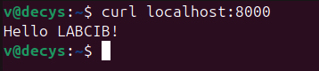

#+begin_src sh
  > docker exec captest sh -c 'capsh --print'
#+end_src

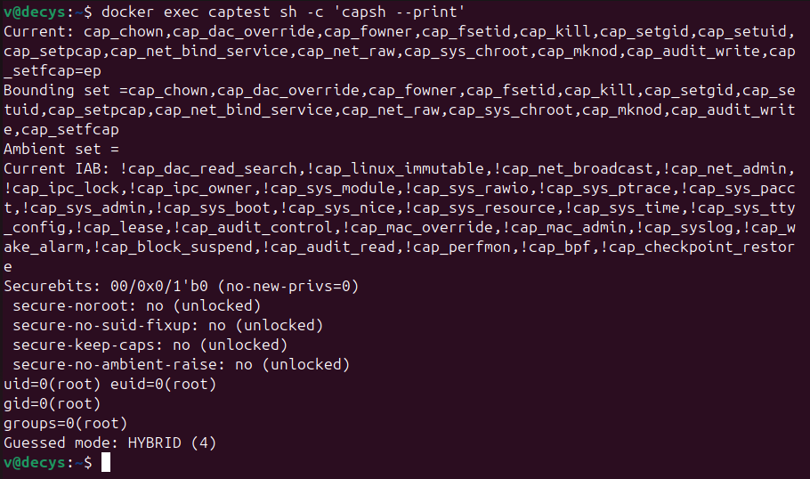

#+begin_src sh
  > docker exec captest sh -c 'grep Cap /proc/1/status'
#+end_src

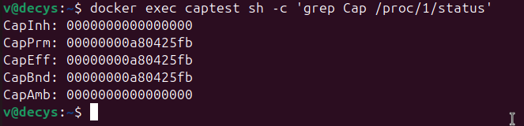

#+begin_src sh
  > docker exec captest sh -c 'capsh --decode=00000000a80425fb'
#+end_src

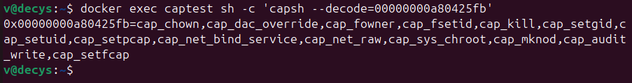

** proc filesystem (=/proc/1/status=)

| field      | value              | meaning                                   |
|------------+--------------------+-------------------------------------------|
| CapInh     | =0000000000000000= | inheritable: *empty*                      |
| CapPrm     | =00000000a80425fb= | permitted: the 14 default capabilities    |
| CapEff     | =00000000a80425fb= | effective: same 14 (active)               |
| CapBnd     | =00000000a80425fb= | bounding: caps may never exceed these 14  |
| CapAmb     | =0000000000000000= | ambient: empty                            |

- *Inheritable = 0* and *Ambient = 0*: nothing is passed across an =execve= to
  non-privileged programs; capabilities come from the file/bounding rules, not
  inheritance.
- *Permitted = Effective*: every capability the container has is already active.
- *Bounding = Permitted*: the container can never raise a capability outside
  this default set, even for a setuid-root binary.

Decode of =CapEff= (=capsh --decode=00000000a80425fb=), the Docker default set:

#+begin_quote
cap_chown, cap_dac_override, cap_fowner, cap_fsetid, cap_kill, cap_setgid,
cap_setuid, cap_setpcap, cap_net_bind_service, cap_net_raw, cap_sys_chroot,
cap_mknod, cap_audit_write, cap_setfcap
#+end_quote

That is 14 capabilities, a smaller subset of the 40-ish the kernel
defines. Notably *absent*: =cap_sys_admin=, =cap_net_admin=, =cap_sys_module=,
=cap_sys_ptrace=, =cap_sys_time=, etc. (the host-dangerous ones from Q10).

** Compare to =capsh --print=

=capsh --print= shows the *same* information in symbolic form rather than hex:

- =Current:= - the thread's effective/permitted/inheritable sets, i.e. the
  same 14 names listed above (permitted+effective), with inheritable empty.
- =Bounding set=- the same 14 names, matching =CapBnd=.
- =Ambient set= - empty, matching =CapAmb=.

So the =capsh= is just the human-readable decode of the numbers in =/proc/1/status=.

* Q13: ping under =--cap-drop all=, and how to fix it

#+begin_src sh
  > docker exec captest sh -c 'ping 127.0.0.1'
#+end_src

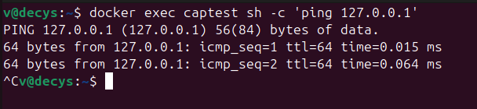

#+begin_src sh
  > docker stop captest; docker rm captest
  > docker run --name captest --cap-drop all -d -p 8000:80 isepdei/capabilities01
  > docker exec captest sh -c 'ping 127.0.0.1'
#+end_src

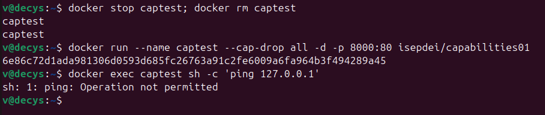

Yes there is an issue. Restarting with =--cap-drop all= empties every capability set,
including the *bounding* set (=CapPrm = CapBnd = 0=).

#+begin_src sh
  > docker exec captest sh -c 'grep Cap /proc/1/status'
#+end_src

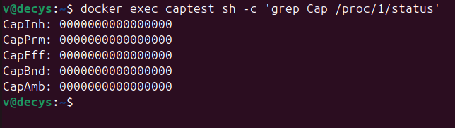

The subtlety is *how* ping breaks:

#+begin_src sh
    docker run --name captest --cap-drop all -d -p 8000:80 isepdei/capabilities01
    docker exec captest sh -c 'ping -c1 www.dei.isep.ipp.pt; echo exit=$?'
    # sh: 1: ping: Operation not permitted
    # exit=126
#+end_src

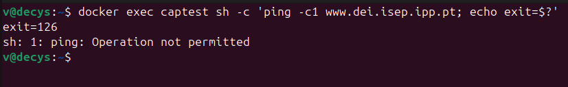

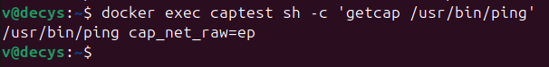

** Fix

Add back the one capability ping needs, *cap_net_raw*:

#+begin_src sh
  > docker stop captest; docker rm captest
  > docker run --name captest --cap-drop all --cap-add net_raw \
    -d -p 8000:80 isepdei/capabilities01
  > docker exec captest sh -c 'ping -c2 127.0.0.1'   # works
#+end_src

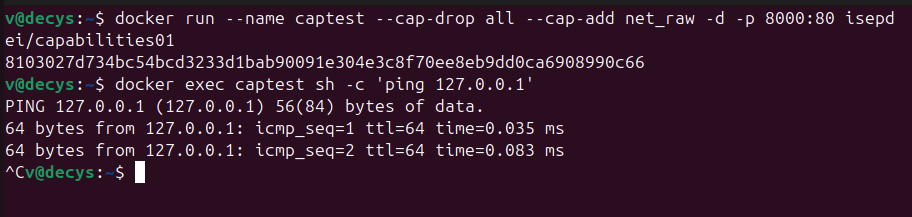
