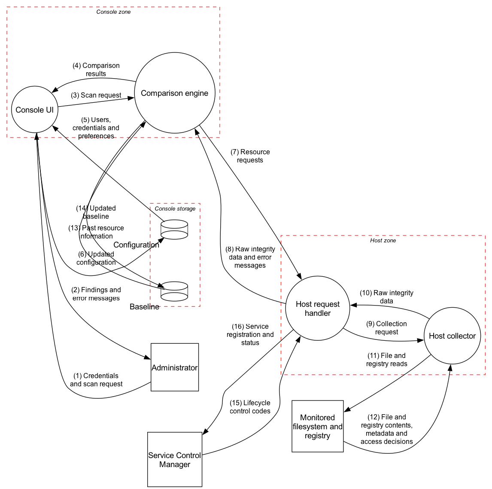

# Level 1: decompose

Opens each level 0 process into its parts and adds the data stores. Normal network mode only; bootable mode is described separately.

## Level 1 in one minute

This is the same normal-mode story as level 0, but the hidden internal hand-offs are now visible.

1. The administrator talks to the Console UI.
2. The Console UI passes the scan request to the Comparison engine.
3. The Comparison engine asks the Host request handler for data.
4. The Host request handler asks the Host collector to read the machine.
5. The Host collector reads files and registry keys and sends raw integrity data back.
6. The Comparison engine compares that data with the Baseline and shows the result through the Console UI.

What this level adds: the baseline and configuration become separate assets, the host split shows where requests are parsed and where files are read, and Windows service control becomes visible.

## From level 0 to level 1

Every level 0 element is kept or split. Nothing is dropped.

| Level 0 | Level 1 | Why |
| --- | --- | --- |
| Administrator | Administrator | Unchanged. |
| AppShield Console | Console UI, Comparison engine | The brief gives the console two jobs: talking to the user ("direct the admin console to establish a connection") and analysing ("compares it with locally stored trusted data"). |
| (not shown) | Baseline, Configuration | The brief: the console stores "locally stored trusted data regarding past resource information" and "configuration data, such as users, credentials, and preferences". Level 0 left them out as internal. |
| AppShield Application (host) | Host request handler, Host collector | The brief gives the host two jobs: "receive requests ... and furnish corresponding responses", and read files and registry keys to produce "raw integrity data". |
| Monitored filesystem and registry | Monitored filesystem and registry | Unchanged. |
| (not shown) | Service Control Manager | The host "operates as a service on a Windows server", so Windows starts and stops it. |

Level 0 flows map to level 1 flows as follows.
Read this as a zoom-in, not as a second and different execution:

- A **level 0 flow** is one big arrow between big boxes.
- A **level 1 flow** shows what that same arrow becomes after one big box is opened.
- When the table says **"then"**, it means the old arrow is now split into two smaller steps because some work that was hidden inside a level 0 box is now visible.

| Level 0 flow | At level 1 it becomes |
| --- | --- |
| 1 Credentials and scan request | 1 Administrator -> Console UI (credentials and scan request), then 3 Console UI -> Comparison engine (scan request only) |
| 2 Resource requests | 7 Comparison engine -> Host request handler |
| 3 File and registry reads | 11 Host collector -> Monitored filesystem and registry |
| 4 File and registry contents and metadata | 12 Monitored filesystem and registry -> Host collector |
| 5 Raw integrity data | 10 Host collector -> Host request handler, then 8 Host request handler -> Comparison engine |
| 6 Detected alterations | 4 Comparison engine -> Console UI, then 2 Console UI -> Administrator |

Flows 5, 6, 9, 13, 14, 15 and 16 are new: they were inside a level 0 circle or outside the level 0 scope.

<figure>

<figcaption>Level 1 DFD.</figcaption>
</figure>

| Flow | From | To | Data |
| --- | --- | --- | --- |
| 1 | Administrator | Console UI | Credentials and scan request |
| 2 | Console UI | Administrator | Findings and error messages |
| 3 | Console UI | Comparison engine | Scan request |
| 4 | Comparison engine | Console UI | Comparison results |
| 5 | Configuration | Console UI | Users, credentials and preferences |
| 6 | Console UI | Configuration | Updated configuration |
| 7 | Comparison engine | Host request handler | Resource requests |
| 8 | Host request handler | Comparison engine | Raw integrity data and error messages |
| 9 | Host request handler | Host collector | Collection request |
| 10 | Host collector | Host request handler | Raw integrity data |
| 11 | Host collector | Monitored filesystem and registry | File and registry reads |
| 12 | Monitored filesystem and registry | Host collector | File and registry contents, metadata and access decisions |
| 13 | Baseline | Comparison engine | Past resource information |
| 14 | Comparison engine | Baseline | Updated baseline |
| 15 | Service Control Manager | Host request handler | Lifecycle control codes |
| 16 | Host request handler | Service Control Manager | Service registration and status |

## Trust boundaries

Level 0 had the console zone and the host zone. Level 1 adds console storage.

- **Console zone**: Console UI and Comparison engine. Flows 1 and 2 cross it at the administrator.
- **Console storage**: around Baseline and Configuration (flows 5, 6, 13, 14). Whoever can write these files controls what the console believes.
- **Host zone**: Host request handler and Host collector. Flows 7 and 8 cross the network into and out of it. Flows 11, 12, 15 and 16 cross it at Windows.

## Assumptions and scope

Carried over from level 0: credentials on the login, administrator local to the console, one host drawn, Windows part of the external entity.
New at level 1:

- **The split is ours.** The brief does not name the parts. Two processes per component follow the brief's verbs.
- **Console UI and Comparison engine run in one program on one machine.** Flows 3 and 4 are local calls and do not cross the network.
- **Baseline and configuration are local files on the console machine.** The brief says configuration is stored "on local files". For the baseline it only says "locally stored".
- **The Console UI manages the configuration (flow 6).** The brief lists users and preferences as stored data, so something must update them. Assumed to be the UI.
- **The Comparison engine alone writes the baseline (flow 14).** The brief does not say who accepts a new baseline.
- **Host request handler and Host collector run in one process.** Flows 9 and 10 cross no boundary, but they are drawn because the parts have different jobs (parse requests, read files).
- **The Service Control Manager is part of Windows.** Drawn separately because it is a second way to affect the host, besides the network.
- **Bootable mode not shown.** Same reason as level 0.

## OWASP phase 1 lists

Only rows new at this level; IDs continue from level 0.

Read these rows as details behind the one-minute story above. Level 1 mainly exists to show three things level 0 hides: stored trust (baseline and configuration), internal hand-offs inside the console and host, and Windows service control.

### External dependencies

| ID | Description |
| --- | --- |
| ED5 | Service Control Manager. It starts and stops the host service. Anyone who can manage services on the monitored machine can stop reporting without touching AppShield. |
| ED6 | Local file storage on the console machine. The baseline and the configuration sit on it. The brief mentions no protection by AppShield, so Windows file permissions are the only barrier. |
| ED7 | System clock on each machine. "Date and time of the most recent update" is one of the compared factors. Windows sets file dates, and a changed clock or hand-set date can hide a modification. |
| ED8 | C++ runtime and memory model on the host. C++ does no bounds checking, so data from the network and from files must be handled with care. |

### Trust levels

| ID | Name | Description |
| --- | --- | --- |
| TL6 | Console machine administrator | Can read and write the baseline and configuration files, and replace the console program. Outside AppShield's login. |
| TL7 | Service manager on the monitored machine | A Windows administrator who can start, stop or reconfigure the host service. |

### Entry points

| ID | Name | Flow | Description | Trust levels |
| --- | --- | --- | --- | --- |
| EP5 | Configuration read | 5 | The UI reads users, credentials and preferences when someone logs in. | TL2 and TL6 can change the file; TL3 intended |
| EP6 | Baseline read | 13 | The engine reads the past resource information at every comparison and trusts it as the truth. | TL6 can change the file; the engine only is intended |
| EP7 | Service control | 15 | Windows delivers start, stop and pause to the host service. | TL7 |

Level 0 entry points still apply, now on the smaller parts: EP1 is flow 1 into the Console UI, EP2 is flow 7 into the Host request handler, EP3 is flow 8 into the Comparison engine, EP4 is flow 12 into the Host collector.

### Exit points

| ID | Name | Flow | Description | Trust levels |
| --- | --- | --- | --- | --- |
| XP5 | Configuration write | 6 | The UI writes updated users, credentials and preferences. | TL6 |
| XP6 | Baseline write | 14 | The engine writes the new baseline after a comparison. | TL6 |
| XP7 | Error messages to the administrator | 2 | Login failures and scan errors. A message that tells an unknown user from a wrong password lets an attacker list valid accounts. | TL2, TL3 |
| XP8 | Host error messages | 8 | Failures reported to the console, such as access denied or a full path. They describe a machine the caller may not otherwise see. | TL1 |

Flow 16 carries only service status and is not an exit point of interest.

### Assets

| ID | Name | Description | Trust levels |
| --- | --- | --- | --- |
| A6 | Baseline | The trusted record of past state (flows 13, 14). If an attacker changes it, every later scan compares against what the attacker chose. | TL6 |
| A7 | Configuration | Users, credentials and preferences (flows 5, 6). The stored side of A2. | TL6 |
