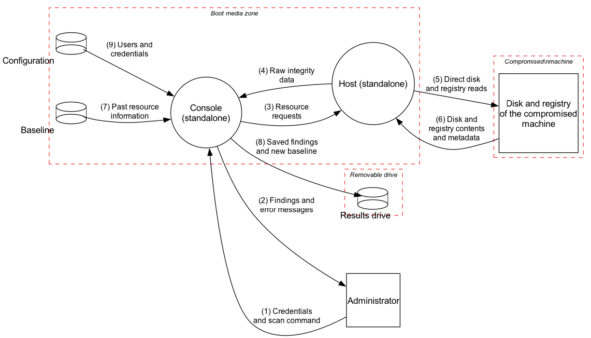

# Level 1, bootable mode: decompose

Bootable mode is a different scenario from normal mode (lecture 02, slide 25: a level 1 diagram is a single feature or scenario), so it has its own diagram.
The brief: both components "can be executed from a bootable CD or USB drive" on a machine "that has been compromised and can no longer be deemed secure", inside "a trustworthy, read-only Windows environment". Both components "extract data from the compromised machine, sidestepping the potentially compromised operating system". The host "operates as a standalone console application rather than a Windows service".

## Bootable mode in one minute

This is the offline rescue path. The trusted side is the media, not the machine.

1. The machine boots from trusted media.
2. The operator logs in and starts a scan.
3. The Console asks the local Host tool to read the disk and registry directly.
4. The Host reads the compromised machine without using its normal Windows installation.
5. The Console compares the data with the baseline from the media, shows the findings, and saves results to a removable drive.

In one line: Administrator -> Console -> Host -> Disk and registry -> Host -> Console -> Administrator, with results also written to a drive.

What changes most: there is no network, so network threats drop out, but media integrity, firmware and physical access now matter.

## From level 0 to level 1 bootable

The trust picture flips. In normal mode the machine being scanned is assumed to be where the host lives. Here the boot media is the trusted side and the machine being scanned is the untrusted side.

| Level 0 | Level 1 bootable | Why |
| --- | --- | --- |
| Administrator | Administrator | Now physically at the machine. The brief has no remote console in this mode. |
| AppShield Console | Console (standalone) | Runs from the media. |
| AppShield Application (host) | Host (standalone) | A console application, not a service, so no Service Control Manager. |
| Monitored filesystem and registry | Disk and registry of the compromised machine | Read directly, not through Windows. |
| (not shown) | Baseline, Configuration | Same stores as level 1; here they come with the media. |
| (not shown) | Results drive | The environment is read-only, so findings and a new baseline can only be saved to a removable drive. |

Read this as the same zoom-in idea as normal mode:

- Level 0 shows one large step.
- Level 1 bootable shows the smaller steps inside it.
- If one level 0 flow becomes two level 1 flows, the old single arrow was hiding an internal hand-off.

| Level 0 flow | At level 1 bootable it becomes |
| --- | --- |
| 1 Credentials and scan request | 1 Administrator -> Console |
| 2 Resource requests | 3 Console -> Host |
| 3 File and registry reads | 5 Host -> Disk and registry |
| 4 File and registry contents and metadata | 6 Disk and registry -> Host |
| 5 Raw integrity data | 4 Host -> Console |
| 6 Detected alterations | 2 Console -> Administrator |

Flows 7, 8 and 9 are new. The console and host stay as one process each: the brief gives no reason to split a standalone tool further.

<figure>

<figcaption>Level 1 bootable DFD.</figcaption>
</figure>

| Flow | From | To | Data |
| --- | --- | --- | --- |
| 1 | Administrator | Console | Credentials and scan command |
| 2 | Console | Administrator | Findings and error messages |
| 3 | Console | Host | Resource requests |
| 4 | Host | Console | Raw integrity data |
| 5 | Host | Disk and registry | Direct disk and registry reads |
| 6 | Disk and registry | Host | Disk and registry contents and metadata |
| 7 | Baseline | Console | Past resource information |
| 8 | Console | Results drive | Saved findings and new baseline |
| 9 | Configuration | Console | Users and credentials |

## Trust boundaries

- **Boot media zone**: Console, Host, Baseline and Configuration. Trusted, as far as the media is.
- **Compromised machine**: the disk and registry. Untrusted by definition.
- **Removable drive**: the results drive. It is plugged into the compromised machine, so it is exposed to it.

## Assumptions and scope

- **One machine.** Console, host, media and disk are on one machine. No flow crosses a network, so every network threat from level 0 drops out. The brief does not say whether a remote console can still be used; if it can, the normal network-mode analysis applies to that link.
- **Baseline and configuration come with the media.** The console needs "locally stored trusted data". With no writable disk it must come from the media or a second drive.
- **A login still exists.** The console stores "users, credentials, and preferences", so it asks for credentials.
- **Results go to a removable drive.** The brief does not say where output goes. A read-only environment cannot store it elsewhere. Findings are also shown on screen.
- **The media is as writable as its type.** A CD is read-only. A USB drive is writable unless it has a hardware write switch. The brief says "read-only Windows environment", which is the Windows image, not necessarily the whole media.
- **Direct reads mean the host parses disk structures itself.** "Sidestepping the potentially compromised operating system" means no Windows file API, so the host reads raw NTFS and registry data. The brief does not say how.
- **Console and host talk locally.** Flows 3 and 4 stay inside the trusted environment.

## OWASP phase 1 lists

Only rows new compared with level 1 normal mode; IDs continue from it.

Read these rows as the bootable version of the same story: what must be trusted on the media, what belongs to the compromised machine, and where the findings leave the trusted environment.

### External dependencies

| ID | Description |
| --- | --- |
| ED9 | Boot media (CD or USB). Holds the code, the Windows image, and possibly the baseline. Everything depends on it being the genuine, unmodified media. |
| ED10 | BIOS/UEFI firmware of the machine. It decides what boots (boot order, Secure Boot, firmware password). Malware in the firmware sits below the trusted environment and can lie to it. |
| ED11 | The read-only Windows image (for example WinPE). Both components run inside it. Its drivers also read the disk and the keyboard. |
| ED12 | Removable drive for results. Plain file system on a device that moves between machines. |

### Trust levels

| ID | Name | Description |
| --- | --- | --- |
| TL8 | Holder of the boot media or results drive | Whoever carries or stores them can copy, swap or edit them. |
| TL9 | Person with physical access to the machine | Can change boot settings, plug in devices, and sit at the keyboard. |

### Entry points

| ID | Name | Flow | Description | Trust levels |
| --- | --- | --- | --- | --- |
| EP8 | Boot media | none | Code and image loaded at boot. Whoever controls the media controls what runs. | TL8, TL9 |
| EP9 | Operator input | 1 | The operator types credentials and a scan command. The keyboard belongs to the compromised machine. | TL9 |
| EP10 | Disk and registry structures | 6 | Raw disk and registry data parsed by the host. Whoever wrote to the disk decides what the host parses. | TL5 |
| EP11 | Stored data read | 7, 9 | Baseline and configuration read from the media. | TL8 |

Level 0 entry points EP1 to EP4 map as: EP1 is flow 1; EP2 and EP3 no longer exist (no network); EP4 is flow 6.

### Exit points

| ID | Name | Flow | Description | Trust levels |
| --- | --- | --- | --- | --- |
| XP9 | Findings on screen | 2 | The screen belongs to the compromised machine. | TL3, TL9 |
| XP10 | Output to the removable drive | 8 | Findings and the new baseline leave the trusted environment as plain files. | TL8 |

XP2 and XP3 of level 0 (network traffic) no longer exist. XP4 (reads on the machine) is flow 5; the data is already on the compromised machine, so it reveals nothing new.

### Assets

| ID | Name | Description | Trust levels |
| --- | --- | --- | --- |
| A8 | Boot media | The trusted code, image and stored data. This mode only helps if the media is genuine. | TL8 |

A1, A2, A3, A5, A6 and A7 apply as before.
